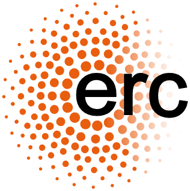

# LagRBF

LagRBF is a software developed to interpolate and advect Lagrangian points in 2- and 3-dimensions using radial basis function (RBF) with the partition of unity (PU) method.

The advection is performed using an explicit integration scheme that can be either:

- Euler forward
- Runge-Kutta 2
- Runge-Kutta 4 (default)
- Dormand-Prince 4(5)

The advection velocity can either be interpolated from a dataset or provided from an analytical function describing the velocity vector at all points in space.

The software is written in C and interfaced with Python, which is the recommended approach to use it.

## Installation

**For detailed installation instructions, see {doc}`installation` or run `./install.sh --help`.**

### Quick Start

```bash
# 1. Install PETSc version 3.25.3 (see install.md for details)
# 2. Install LagRBF
./install.sh -v path/to/python/virtual_env -p path/to/petsc/directory -a name_of_petsc_arch -j 4
```

### Requirements

- **Python**: 3.12+
- **Compiler**: GCC 9+ (other compilers not tested)
- **MPI**: OpenMPI, MPICH, or vendor-specific implementation
- **Linear Algebra**: BLAS and LAPACK libraries
- **PETSc**: 3.25.3 (see {doc}`petsc_config` for details)

### Python Dependencies

- [NumPy](https://numpy.org/)
- [petsc4py](https://petsc.org/release/petsc4py/index.html) (requires PETSc C library)
- [PyVista](https://pyvista.org/)
- [Sphericart](https://sphericart.readthedocs.io/en/latest/) (optional, for analytical flows)

If installation is performed with `install.sh` or step-by-step following the {doc}`installation` guide, these dependencies will be automatically installed.

### Key PETSc Configuration

LagRBF requires [PETSc](https://petsc.org/release/) with at least these options:

```
--with-memalign=32
--with-shared-libraries=true
--with-single-library=true
```

Configuration examples for common platforms are in `petsc_config/`. See {doc}`petsc_config` for detailed platform-specific guidance.

## Documentation
The documentation of the Python API can be found here **TODO**.

## Funding
LagRBF has been developed in project PANDORA European Research Council (ERC) advanced grant, award number 101142672.

